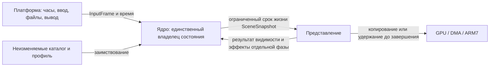

# N03: границы ядра, владение и бюджет DS mode

29 октября 2026 года. Архитектурные решения N03 приняты, реализованы и проверены
на host и эмуляторе. Это собственная архитектура NDS, а не перенос структуры
GBA или наложение DOS-классов на память ARM9. Результат приёмки и команды —
в [паспорте N03](../tasks/N03.md).

## Что определяет этот этап

N03 фиксирует границы подсистем, сроки жизни данных и способ обнаружения
нехватки памяти. Формат пакета, игровые структуры объектов, очередь событий,
геометрия renderer и звуковые команды здесь ещё не реализуются.



Верхний уровень различает состояние мира и представление, но не объявляет
исходное построение сцены чистой функцией. В оригинале рассмотрение объекта
при рисовании связано с пробуждением AI и раскрытием карты. N07/N08/N16/N20
должны установить точный порядок этих эффектов; GPU и ARM7 не получают
права самостоятельно изменять `GameState`.

## Минимальные роли

| Контракт | Владелец и срок жизни | Что намеренно остаётся следующему этапу |
|---|---|---|
| `PlatformServices` | Платформа владеет context и callbacks; живёт дольше оболочки ядра | В N03 часы с явной шкалой и диагностика; read-only package I/O — N04, present — N07, audio — N18, settings-only write — N21 |
| `InputFrame` | Платформа формирует значение; ядро получает заимствованный снимок | Физические кнопки и touch без NDS API; потребление фронтов и управление — N09, игровые часы — N08 |
| `GameState` | Типизированная caller-owned оболочка; изменение только через API ядра | Инициализация оболочки не означает загруженный мир; поля мира и retry — N05/N22 |
| `SceneSnapshot` | Неизменяемое заимствование с epoch/sequence и явным окончанием | Содержимое и feedback видимости — N07/N20; построение не считается чистым |
| `AssetCatalog` | Неизменяемый descriptor, implementation принадлежит загрузчику | Формат, содержимое, рабочий набор и streaming — N04 |
| `BalanceProfile` | Неизменяемый descriptor, implementation принадлежит данным | Конкретные таблицы и принятые числа — N05 |

Объявления и правила API — [N03-contracts](N03-contracts.md). Структуры этого
API не служат дисковым форматом. Фиксированные целочисленные поля не делают
положение указателей и размер host/ARM9 структур одинаковыми.

Долгоживущие игровые ссылки используют логический ID, поколение слота и
epoch мира. Удаление/повторное использование слота не оживляет старую ссылку;
переход к новому миру инвалидирует предыдущий epoch. Повтор уровня внутри
того же мира не приравнивается к полному уничтожению мира: это выясняет N22.
Переполнение счётчиков идентичности должно давать отказ, а не тихое ABA.

Снимок и каталог не передают владение своей памятью потребителю. Пока
потребитель удерживает lease, владелец не может переиспользовать backing.
Асинхронный вывод либо копирует данные в собственный staging, либо явно
удерживает их до сигнала завершения. Сброс frame arena при незавершённом
GPU/DMA/ARM7-чтении запрещён.

## Разделение памяти

Проверенный факт установленного SDK: `ds_arm9.mem` ограничивает образ ARM9
интервалом `[0x02000000, 0x02380000)` — 3 670 016 байт, 3584 КиБ. Верхние
512 КиБ из физических 4 МиБ остаются за SDK/ARM7/boot/shared. Размер реально
загруженного ARM7-кода меньше этой области, но остаток не возвращается
ARM9 поверх принятого linker limit. Это политика порта, а не утверждение
о том, что SDK автоматически ограничивает там динамический heap.

Фактический первый запуск обнаружил `getHeapLimit() = 0x023F4000`, выше
`__eheap_end = 0x02380000`: после startup SDK допускает иное использование
части верхней области. Простое уменьшение heap на 640 КиБ оставляло неверную
границу. N03 сначала отдельно исключает 475 136 байт превышения runtime limit
над принятой областью, затем аварийный резерв. Итоговая граница обязана быть
`0x02380000 - 655360 = 0x022E0000`. Эти две причины исключения не складываются
в процент аварийного резерва. Исходный результат и исправление сохраняются
в `research/evidence/nds/n03/heap-limit-finding/`.

Ниже собственные начальные потолки NDS. Это проверяемые ограничения проекта,
не доказательство, что все будущие ресурсы и тяжёлые сцены уже укладываются.

| Область | КиБ | Срок жизни / назначение |
|---|---:|---|
| Код, SDK static и учтённый startup overhead | 512 | Программа и служебные расходы; map и runtime отдельно |
| Мир | 384 | До уничтожения мира, без загрузки нового мира поверх старого |
| События | 64 | Владение ядра; семантика очереди — N08 |
| Рабочая память | 128 | Ограниченные временные вычисления, явный reset |
| Снимки сцены и render buffers | 256 | До завершения потребителей текущего снимка |
| Кэш ресурсов | 1024 | Рабочий набор, eviction и pinning — N04/N07 |
| Звук | 256 | Main RAM staging, не ARM7 private RAM |
| Платформенный I/O | 128 | Служебные буферы и переносы |
| SDK dynamic heap | 192 | После стартового выделения управляемого блока |
| Аварийный резерв | 640 | Исключён из обычного heap; не раздаётся кэшам |
| **ARM9 main RAM всего** | **3584** | **Без TCM/VRAM и верхних 512 КиБ** |

Семь управляемых областей составляют 2240 КиБ. Платформа выделяет для них
один блок при запуске, а ядро не вызывает `malloc` на каждом кадре. Одиночное
стартовое выделение даёт backing без объявленного C-типа и позволяет
отдельно измерить фактическую цену allocator/alignment. В строгом C11 нельзя
обещать произвольные типизированные объекты поверх объявленного `char[]`:
для них нужны корректно типизированное хранилище либо untyped allocation.
Byte arenas и копирование элементов work stack не выдают такого обещания.

Резерв — 655 360 байт: 17,857% всего ARM9 region и 15,625% физических 4 МиБ.
После потолка static/startup 512 КиБ он составляет 20,833% оставшихся
3 МиБ. Физическое исключение из heap через SDK проверяется в ARM9 probe.
Неиспользованная часть потолка static — отдельный headroom, не ещё один
резерв и не замер памяти полной игры.

При изменении N04/N07/N18 бюджет повторно сверяется с конкретными данными,
пиками и link map. Если рабочий набор не помещается, пересматривается
разбиение/streaming; нельзя молча уменьшать набор объектов, эффекты или звук.

## Ограниченные выделения и измерения

Byte arena — линейное выделение с проверкой размера и выравнивания.
Алгоритмический work stack — ограниченный стек элементов с явными push/pop.
У каждой области есть high-water и диагностический счётчик отказов.
Неверный размер, переполнение арифметики и исчерпание ёмкости не меняют
cursor/depth/high-water, существующие данные и выходной аргумент. Изменение
диагностического счётчика отказов не считается изменением игрового состояния.

High-water work stack не называют глубиной C call stack. Отдельный ARM9
probe окрашивает только свободную область user stack DTCM ниже текущего SP,
проверяет guard и выполняет ограниченную стековую нагрузку. Это pattern
watermark данного запуска; IRQ/SVC и будущая полная игра этим не проверены.
Окончательные стеки и тяжёлые маршруты остаются N23/N24.

Подробные linker/heap/ARM7/TCM/VRAM границы, cache/DMA и команды probe —
[N03-memory](N03-memory.md). TCM не прибавляется к main RAM: ITCM — 32 КиБ,
DTCM — 16 КиБ; они ARM9-only и не подходят для DMA/ARM7 transfer pools.
VRAM — отдельные 656 КиБ банков. Их окончательное распределение — N06/N07.

Передача буфера внешнему потребителю требует целых 32-байтных cache lines,
flush перед внешним чтением и корректного relinquish/invalidate после
внешней записи. До completion буфер нельзя переиспользовать. Эти операции
принадлежат платформе; ядро не включает `nds.h` и не управляет DMA-регистрами.

## Основания и границы восстановления

Источники N01: [native-state](../../originals/native-state.md),
[world](../../originals/world.md), [LEVEL](../../originals/levels.md),
[rendering-assets](../../originals/rendering-assets.md),
[time-events](../../gba/time-events.md) и [матрица N01](N01-subsystems.md).
Последний документ времени содержит также GBA-адаптацию; она не становится
реализацией NDS и не задаёт новую общую частоту логики.

Адреса — Ghidra NE loader, не файловые смещения и не DPMI-селекторы:
owners PKR `1038:0000` / PKE `1010:13AA`, player `1068:1657` / `1020:1B61`,
world load `1098:004F` / `1030:0079`, dynamic slots PKR
`1098:017D/0205/0278`. Они обосновывают различение владельцев, поколений и
времени жизни; их packed/native layout не копируется в C11 API.

На N03 не анализируются новые EXE и не заявляется восстановление новых
игровых функций. Используются существующие Ghidra/ASM-доказательства N01;
фактические механики проверят соответствующие будущие ID.

## Приёмка

- Strict C11 host и ARM9 compile всех контрактов и переносимого кода;
  GNU C11 применяется только в translation unit с SDK.
- Исполнение host tests с граничными размерами, неверным выравниванием,
  переполнением, повторным использованием и сохранностью данных при отказе.
- Настоящее исполнение memory probe ROM в DS-эмуляторе: link symbols,
  heap bounds, одно выделение и его границы, исключённый резерв, high-water,
  ошибки ёмкости и стеки. Наблюдение RAM только для чтения.
- Связь отчётов с точными SHA source/toolchain/ROM/ELF/map, сверка бюджета и
  явное разделение фактических результатов и будущих потолков.

Проверки ниже пройдены; подробные результаты — в паспорте и локальных
первичных отчётах. Промежуточная приёмка — на эмуляторе по [validation-policy](validation-policy.md);
реальные DS/DS Lite, FPS и совместимость loader проверяются в N24.

## Фактический результат N03

Strict C11 host contracts/lifecycle и 28 459 граничных проверок памяти прошли.
Linux x86_64-musl собран и слинкован, но не исполнялся. Все заголовки, ядро и
тесты отдельно скомпилированы ARM9-компилятором в strict C11; только SDK-facing
платформенная единица использует GNU C11. Общий CMake, GBA и SDL2 не подключались.

Memory probe исполняется в melonDS DS libretro core 1.4.0 с replacement BIOS,
DS mode, без SD и оригинальных игровых ресурсов. Пройдены 42 независимые
проверки, получены 120 согласованных состояний, 171 frontend frames.
Проверены ELF/link symbols и реальные heap limits, все 2 293 760 байт
управляемого блока после ARM9-записей, границы арен, отказы и сброс, work stack,
DTCM pattern и CP15 DTCM base/size. RAM наблюдателем не изменялась.

| Фактическая часть ARM9 main RAM | Байт |
|---|---:|
| Static по link map | 42048 |
| Startup heap overhead, включая allocator/alignment | 7104 |
| Управляемые области | 2293760 |
| Оставшийся рост heap до policy limit | 671744 |
| Исключённый аварийный резерв | 655360 |
| **Всего, в точности ARM9 region** | **3670016** |

Из 671 744 байт роста heap 196 608 составляют принятый минимум SDK, остальные
475 136 — незанятая часть потолка code/startup. Это не статистика свободных
malloc chunks. DTCM pattern watermark в окрашенном диапазоне изменился с 0
до 544 байт, нижний guard цел. Work stack достиг 8 элементов и безопасно
отклонил девятый push. Нельзя переносить эти значения на полную игру.

```powershell
C:/Source/wasdify/.venv/Scripts/python.exe -X utf8 ports/nds/tools/check_core.py
C:/Source/wasdify/.venv/Scripts/python.exe -X utf8 ports/nds/tools/run_memory_emulator.py --core C:/Users/dspev/AppData/Local/Programs/melonDS-DS/1.4.0/melondsds_libretro-win32-x86_64-Release/cores/melondsds_libretro.dll
```

Версии: CPython 3.14.6, общий Zig 0.13.0, BlocksDS 1.24.0-1, ARM GCC 16.2.0.
Первичный host/build отчёт — `research/evidence/nds/n03/host-check.json`,
ARM9 build — `build/nds/n03/build-report.json`, постоянный runtime —
`research/evidence/nds/n03/emulator/result.json`. Источники и SHA —
`research/evidence/nds/n03/source-manifest.json`; SDK provenance — соседние
`sdk-memory-layout.json` и `sdk-runtime-heap-evidence.json`.
Компактный итог — [analysis/nds-n03-architecture.json](../../../analysis/nds-n03-architecture.json).
Точные ROM/ELF/map SHA приведены в паспорте. Финальные PNG просмотрены:
TOP/BOTTOM верны, числа и ограничения читаемы.
